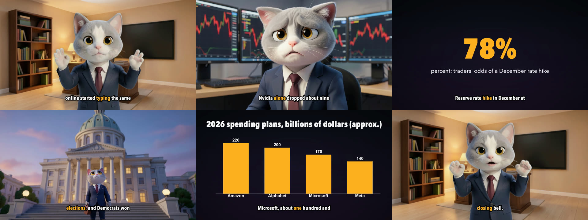
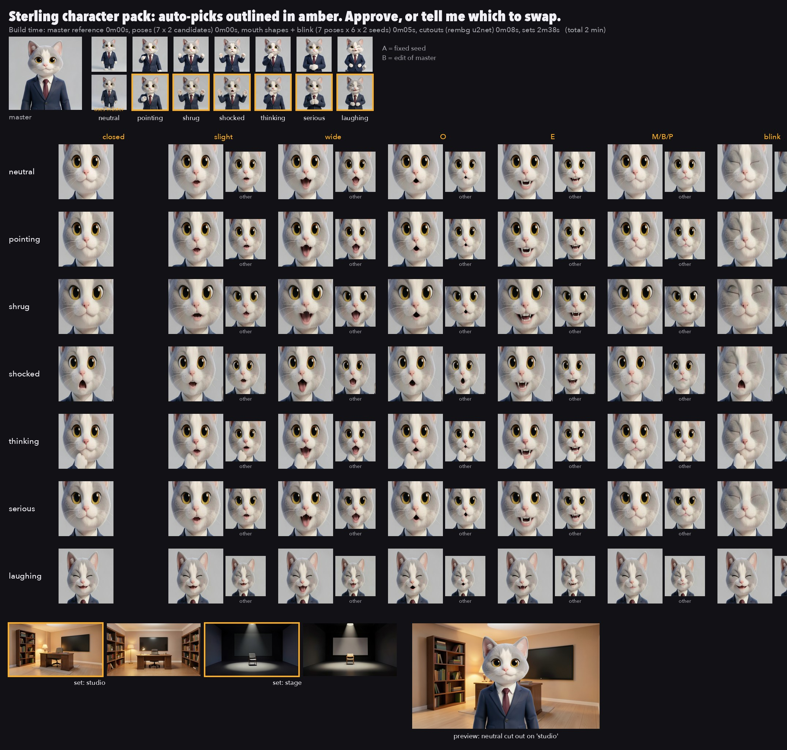

# Video Studio

**Turn a plain-text script into a finished, upload-ready YouTube video on your own Mac.**
A local web app that voices the script, draws the pictures, animates a lip-synced cartoon presenter, adds captions
and music, and hands you the MP4, thumbnails and description. Long videos and vertical Shorts.



**Renders entirely offline after a one-time model download. No paid APIs, no API keys, no cloud GPU.**
It costs nothing to run and nothing leaves your machine. You write the script (by hand or with any chatbot), and
the rest happens locally.

## How it works

```
script.md  ──►  Check  ──►  Draft (≈1 min, placeholders)  ──►  Final  ──►  final.mp4 + thumbnails + metadata.txt
(plain text,     (errors and      (check voice, pacing,           (1080p, AI images,      upload_pack.zip
 shot tags)       pacing tips)      captions, graphics)              presenter, -14 LUFS)    → YouTube Studio by hand
```

A script is narration with shot tags. A tag changes the picture exactly where the next words start:

```
---
title: Big Tech Is Spending $2 Billion a Day on AI #Shorts
type: short
character: sterling
---
[talk: shocked | studio]
Two billion dollars. Every single day.
[number: 730 | billion dollars: Big Tech's spending plans for 2026 | prefix=$ suffix=B]
About seven hundred and thirty billion dollars this year.
[act: standing in a long data center aisle with blue server lights, looking up at the towering racks | wide]
Mostly chips, servers and giant data centers.
```

- `[talk: pose | set]`: the presenter on camera, lip-synced to the voice
- `[act: what he does + where | wide/medium/close]`: the presenter in an AI-generated scene
- `[ai: ...]`, `[stock: ...]`: an AI image, moved with a 2.5D depth camera move
- `[card: ...]`, `[number: ...]`, `[quote: ...]`, `[chart: bar|line ...]`: animated graphics
- `[sfx: whoosh]`, `[pause: 1]`

Full format: [docs/SCRIPT_FORMAT.md](docs/SCRIPT_FORMAT.md). Prompts for writing scripts with an AI chatbot:
[docs/CLAUDE_SCRIPT_PROMPT.md](docs/CLAUDE_SCRIPT_PROMPT.md).

### Two video types
| | Full video | Short |
|---|---|---|
| Size | 1920×1080 | 1080×1920 |
| Length | 10-14 min, chapters | 15 s to 2:00 |
| Music | per chapter, crossfaded | one track, loops |
| Captions | word-by-word, bottom | bigger, clear of the Shorts buttons |
| Thumbnails | 3 options for A/B tests | 1 vertical cover |

A Short can be written from scratch, or **cut from a video you already made**: pick the video and a start/end,
and it re-frames that part vertically with the presenter centred, reusing its voice and images (no new AI images,
about 40 seconds).

### Presenter characters
Each character is a text file ([docs/characters/](docs/characters/)) with a fixed look, seed, voice, poses and
sets. `tools/make_character_pack.py` turns it into a pose pack: a master reference, 7-8 poses, six mouth shapes
plus a blink per pose, cut-outs and sets (about 2-2.5 hours, once). The example character is Sterling:



Sterling is the author's channel character (see [NOTICE](NOTICE)). Build your own from `miso`, `biscuit`,
`nova` or a file you write.

## The stack (all local)

| Step | Tool | Licence |
|---|---|---|
| Images | **FLUX.2 [klein] 4B**, 4-bit, through mflux on Apple Silicon (MLX), kept loaded during a render | Apache-2.0 |
| Voice | **Kokoro-82M**, with per-word timings and phonemes (they drive the captions and lip sync) | Apache-2.0 |
| Backup word timings | **whisper.cpp** (ggml-small) | MIT |
| 2.5D camera moves | **Depth Anything V2 Small** (depth map) + OpenCV | Apache-2.0 |
| Character cut-outs | rembg (u2net) | MIT / Apache-2.0 |
| Graphics | Pillow + matplotlib, bundled Barlow fonts | OFL |
| Captions, mix, encode | **FFmpeg**: libass word-by-word captions, ducked music, two-pass loudness to −14 LUFS, hardware H.264 (VideoToolbox on Mac, NVENC on NVIDIA, else x264) | LGPL/GPL |
| App | Flask + one plain HTML page, login, render queue with resume | MIT (this repo) |

Measured on a MacBook Air M5 (16 GB, fanless): about 20-30 s per AI image. A 7:44 presenter video renders in
about 4 minutes once its images are cached, and a 30-40 s Short takes about a minute.

## Quick start

You need an Apple Silicon Mac (M1 or newer, 16 GB RAM recommended), about 20 GB of free disk and about an hour.
Follow **[docs/FRIEND_SETUP.md](docs/FRIEND_SETUP.md)** step by step. In short:

```bash
git clone https://github.com/varunreddy033/video-studio ~/youtube-pipeline
bash ~/youtube-pipeline/setup.sh
~/youtube-pipeline/bin/python ~/youtube-pipeline/render_server.py
```

Then open the `FIRST RUN` link it prints to create your login, add your own music to `assets/audio/bgm`, and
build a character (`bin/python tools/make_character_pack.py miso`). The guide also covers putting the page
online at your own `https://<your-name>.<your-tailnet>.ts.net` address with Tailscale Funnel (free; each
person sets up their own), auto-start, and keeping the Mac awake during long renders.

**Not included** (see [NOTICE](NOTICE)): music and sound effects (bring your own, e.g. from the YouTube Audio
Library) and generated character packs (you build your own). Uploading is manual in YouTube Studio.

## Daily use
1. Write the script (prompts in `docs/CLAUDE_SCRIPT_PROMPT.md`) and check the facts.
2. **Make full video** or **Make Short** → paste → **Check** → fix red errors (click one to jump to the line).
3. **Save & make draft**: low resolution with placeholder images; check the voice, pacing and graphics.
4. **Make final**: 1080p, AI images, presenter, thumbnails, `metadata.txt` (title, description, chapters,
   music credit, tags, upload checklist) and `upload_pack.zip`.
5. Upload in YouTube Studio (private first) and tick "altered or synthetic content".

Every video lives in `output/jobs/<id>/` with its script, videos, thumbnails, captions (`.srt`) and a `cache/`
that makes re-renders fast. `output/` is not in git: back up what you keep.

## Other machines
The code also runs on Windows/Linux (encoder auto-detect, bundled fonts, UTF-8 everywhere). There, everything
that doesn't need a NEW AI image works: clip Shorts, presenter Shorts with talk + graphics, drafts. New images
need the Mac (mflux is Apple Silicon only). Move a character pack between machines with
`tools/export_character_pack.py <id>` and `tools/import_character_pack.py <zip>` (checksummed). Force an encoder
with `VIDEO_ENCODER=libx264` in `.env`.

## Troubleshooting

| Symptom | Fix |
|---|---|
| Page won't load | Start the server (command above). From outside: the Mac must be awake and the Tailscale tunnel running. |
| Forgot password | Admin: Account screen. Last admin: delete `data/users.json`, restart, use the FIRST RUN link in `output/server.log`. |
| A render failed | Open the job, read the red box and the render log, press the render button again: finished voice and images are reused. |
| "Waiting for <name>'s character pack" | Build it: `bin/python tools/make_character_pack.py <name>`; the final starts by itself. |
| Sound effect skipped | No file in `assets/audio/sfx` matches the cue word. Add one with that word in its file name. |
| Mac hot / slow on long finals | Normal for AI images on a fanless Air. Close big apps, keep it plugged in with the lid open. |

## Licence
Code: MIT, see [LICENSE](LICENSE). Third-party models, fonts and what's not included: [NOTICE](NOTICE).
